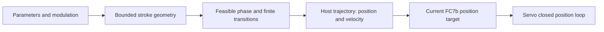

# Motion planner audit — October 3 and 13, 2026

The October 13 continuation describes the current **local browser hardware
planner**. It supersedes the October 3 trajectory implementation below. The new
revision has not been deployed. Its watched 1.5 Hz sine and browser-control
checks are recorded below.
Historical acceptance applies only to the particular earlier version and run.
Neither offline results nor those trials establish general smoothness or parity
with stock firmware.

## October 13 continuation: continuous commanded state

The prior browser tracker already retained velocity between ordinary samples.
The reproduced defect was acceleration chatter on a still-rising, feasible
1.5 Hz / 70% sine: near the upper turn, commanded velocity changed from
+3.988 to -8.012 to 0 mm/s across 2 ms steps, with acceleration switching from
-6000 to +4005.75 mm/s². Its position-only boundary fallback could invoke a
rest-point planner too early. This proves a host-planner discontinuity; neither
FC7b nor the vendor manual establishes that the motor resets velocity for every
replacement target. The two issues must not be conflated.

The replacement retains commanded **position, velocity and acceleration (PVA)**
in C2 trajectories: all three state values are continuous.
Capture and parameter transitions target a future moving PVA state, including
its nonzero velocity and acceleration, through the local Ruckig core. Compatible
intermediate points do not acquire a zero terminal velocity merely because a
USB command is sent. For a fixed waveform, capture joins the continuous
reference; modulation uses retained finite trajectories and a fixed replanning
grid. A necessary bounded braking transition may precede capture when a new
reference cannot be reached safely.

Triangle, square and saw references use finite jerk-limited Ruckig legs. Actual
end reversals have zero velocity and acceleration; square can dwell and saw has
an explicit finite return leg. These replace impossible sharp ideal corners.
The fixed sine retains its analytic PVA reference. Full trajectory extrema and
jerk-aware stopping paths must fit the permitted rail corridor before admitting
an output state; checking just the next point or `v²/(2a)` is insufficient.
Commanded PVA remains a model, separate from measured encoder motion.

| Budget or setting | Current local value |
| --- | ---: |
| Host velocity / acceleration | 1080 mm/s / 6000 mm/s², retained |
| Host jerk | 100000 mm/s³ |
| Reference reserve | 95% of each host V/A/J limit |
| Reference V / A / J | 1026 mm/s / 5700 mm/s² / 95000 mm/s³ |
| Drive profile | `servo_ramped`, register 3 = 20000 RPM/s, retained |
| Nominal drive acceleration | 13333 mm/s² at 40 mm/revolution |
| Connected baud for this comparison | 19200, retained; no baud commissioning |

For sine half-amplitude A and frequency f, peak demands are
`V = 2πfA`, `a = (2πf)²A`, and **`J = (2πf)³A`**. Its planned rate is bounded by
`min(Vref/(2πA), sqrt(aref/A)/(2π), cbrt(Jref/A)/(2π))` for A > 0.
The 95% reserve leaves capture headroom; it does not reduce the hard output
ceilings a second time or change the drive setting. Center still contracts the
available stroke near an end, and requested versus planned rates remain distinct.

Ruckig Community 0.15.3 is pinned and bundled as a 170258-byte local WASM module.
Browser startup asynchronously loads that sibling asset and gates motion until
it is ready; subsequent calculations and samples are synchronous and offline.
There is no CDN or cloud waypoint service. The C ABI corrects upstream extrema
metadata omissions analytically and uses Time synchronization for minimum
trajectory durations, without modifying the planner source. Source hashes,
MIT/runtime licenses and an exact portable WASI SDK build are documented in
[the core README](../vendor/ruckig/README.md) and [NOTICE](../NOTICE.md).

A recovered guard reply or uncertain target acknowledgment during an active
pattern now inhibits the run. It cannot freeze a moving PVA reference and then
resume it across an unaccounted motion interval. Fresh read-only recovery and
Stop verification remain possible; another Play requires confirmed stationary
capture, with fault reset if needed. Missed targets are never replayed or queued.

Offline verification passed **267/267 browser checks**, including **13 core
checks**. Independent native C++/WASM comparison covered 500 varied PVA and
minimum-duration cases, with maximum absolute output difference 1.31e-13.
The binary rebuilt to the identical SHA-256. A local benchmark averaged 3.92 µs
per calculation/sample/braking pair; it measures computation only.

The 19200-baud comparison still has approximately 20 target updates/s, browser
and USB timing variability, a drive ramp and only sampled encoder feedback.
Modulated paths remain bounded finite captures; clipping, fast parameter changes
and infeasible desired derivatives can alter phase or stroke, require braking,
or fail closed. A fixed-sine capacity formula does not prove modulation fidelity.
The watched fixed-sine acceptance below applies to that pattern and load. It
does not establish modulation fidelity or parity with motor-local firmware.

## October 13 connected acceptance

The user explicitly authorized hardware motion. The production JavaScript
engine, runtime, transport and serial framing ran through an exclusive native
serial pipe, with no higher velocity/acceleration ceiling or baud change.
The first Home cancelled on encoder movement during control-mode preparation
and confirmed inhibition. A fresh stationary retry succeeded, measuring
**179.691162 nominal mm**. Five separate six-second centered runs then completed
without motion faults; each sent 119 targets (19.833/s) and confirmed Stop.

| Trial | Sent span, mm | Sampled encoder span, mm | Median gap, ms | Largest gap, ms | Stop |
| --- | ---: | ---: | ---: | ---: | --- |
| 0.5 Hz / 30% sine | 42.166 | 42.076 | 49.95 | 68.90 | Confirmed |
| 1 Hz / 70% sine | 97.363 | 97.162 | 50.14 | 58.63 | Confirmed |
| 1.5 Hz / 70% sine | 98.240 | 96.058 | 49.98 | 55.33 | Confirmed |
| 1 Hz / 70% triangle | 98.254 | 97.454 | 49.97 | 69.38 | Confirmed |
| 2.5 Hz / 30% sine | 41.119 | 38.751 | 49.87 | 58.99 | Confirmed |

The requested and planned rates matched in all five runs. The user watched the
**1.5 Hz / 70% sine** and reported **“Smooth with useful speed.”** This is
physical acceptance of that tested pattern and load. The triangle and 2.5 Hz
runs establish operation and Stop; no separate visual verdict was recorded.
At 20 target replies/s, sampled ranges can miss extrema, particularly at 2.5 Hz.
The encoder spans do not separate sampling loss from servo following lag.

The private pipe's EOF safeguard drains two replies for 200 ms each, exceeding
the production 300 ms closure deadline. Closing reported a cleanup timeout
rather than asserting success. A subsequent exclusive read-only check verified
three identical CRC-valid positions with output, speed, PWM, pending demand and
alarm all zero, then verified port release. No production Stop or closure limit
was relaxed to accommodate the harness.

The rebuilt app was then checked in desktop Chrome at
`http://127.0.0.1:8769/`: USB adapter connection, fresh Home (about 179.7 mm),
Play with a 0.25 Hz / 70% sine, and Stop all succeeded through the normal UI.
The UI returned **STOPPED**, **Homed**, and **Stop verified: Confirmed**.
The app remains connected and stopped, set to the previously accepted
approximately 1.5 Hz / 70% sine for the user's next Play. Browser timing was
not captured as a native-trace benchmark. Raw debugger inspection was denied;
normal controls provided the browser acceptance evidence.

Current validation: **267 browser tests and 132 Python tests pass**. The
standalone export includes the local WASM and notices; all 14 manifest assets
match SHA-256. Source hashes and the native trial summary are retained in
[the machine-readable evidence](qa/2026-10-13-continuous-motion.json).
The stopped Chrome result is shown in [the screenshot](images/continuous-motion-2026-10-13.jpg).

## October 3 audit and trials (historical)

The slow-sine test established visible smoothness at 0.25 Hz / 30% stroke.
It did not establish useful speed or smoothness under demanding curves. That
test required only about 33.5 mm/s and 52.6 mm/s². The user's subsequent report
of slow movement and jitter on curves was the reason for the first audit.
The implementation descriptions and measurements in the remaining October 3
sections refer to that earlier local revision, including its lack of jerk limiting.

## Where performance was lost

| Stage | Finding | Effect |
| --- | --- | --- |
| Geometry | Stroke multiplies the room on both sides of Center | Off-center motion can be much shorter than the Stroke knob suggests |
| Host acceleration | The ramped default limited acceleration to 1200 mm/s² | Many ordinary curves were infeasible despite ample velocity headroom |
| Drive acceleration | Register 3 was also set to 2000 RPM/s, about 1333 mm/s² | A second trajectory ramp added lag to already planned targets |
| Phase | Requested phase kept advancing while the pursuit planner saturated | Planned stroke collapsed instead of preserving travel at a feasible rate |
| Endpoint pursuit | Square endpoints used velocity = feed + 6 × position error | Approach was gradual and left available velocity unused |
| Corners/flyback | Triangle corners and saw resets had no finite transition time | Triangle overshoot and large saw attenuation |
| Serial | At 19200 baud, observed complete cycles reached 51.89 ms | About 20 target updates/s; 2 ms host substeps do not reach the drive |

The hardware Arm path replaces the preview's normalized velocity and
acceleration limits with the transport's physical budgets divided by the
measured span. Run preserves them. There is no additional legacy preview
velocity cap in hardware. The 90% velocity reserve is applied once: drive
speed ceiling 1800 RPM is 1200 nominal mm/s; host ceiling is 1080 mm/s.

## Geometry and first-principles demand

The assumed conversion is 32768 encoder counts/revolution and 40 mm/revolution,
or 819.2 counts/mm. The watched Home measured about 181.57 nominal mm between
contacts. Subtracting the existing 1638-count inset at each end leaves
177.571 mm. The default 10–90% command window spans 142.057 mm.

For that window W, stroke fraction s, and center fraction c:

`A = s × W × min(c, 1-c)`; full displacement `D = 2A`.

70% Stroke at 50% Center requests 99.44 mm. The earlier 62% Stroke / 8% Center
setting requests 14.09 mm; at 50% Center it requests 88.08 mm. This geometry is
preserved, and the UI now shows the resulting distance and explains contraction.

For a fixed sine:

`peak velocity = π f D`

`peak acceleration = 2 π² f² D`

`maximum feasible f = min(V / (π D), sqrt(a / (2 π² D)))`

| Sine request | Full displacement | Peak velocity | Peak acceleration |
| --- | ---: | ---: | ---: |
| 0.25 Hz / 30% | 42.62 mm | 33.47 mm/s | 52.58 mm/s² |
| 0.5 Hz / 70% | 99.44 mm | 156.20 mm/s | 490.72 mm/s² |
| 1.5 Hz / 70% | 99.44 mm | 468.60 mm/s | 4416.44 mm/s² |
| 2.5 Hz / 30% | 42.62 mm | 334.71 mm/s | 5257.67 mm/s² |

The last two requests fit the existing 6000 mm/s² streaming budget but exceed
the 1200 mm/s² ramped budget. Velocity was not the binding limit.

## Comparison with motor-local firmware

The current [stock OSSM configuration](https://github.com/KinkyMakers/OSSM-hardware/blob/main/Software/src/constants/Config.h)
sets 1500 RPM, 40 mm/revolution, 800 pulse steps/revolution, and 50000 mm/s².
That is a 1000 mm/s speed ceiling and 20000 step pulses/s at maximum speed.
Its [streaming task](https://github.com/KinkyMakers/OSSM-hardware/blob/main/Software/src/ossm/streaming/streaming.cpp)
passes motion parameters to [FastAccelStepper](https://github.com/gin66/FastAccelStepper),
which generates pulses continuously with hardware timing. Application polling
frequency and pulse timing are different jobs.

The earlier browser's 1200 mm/s² ramped ceiling was only 2.4% of that configured
stock acceleration. Rest-to-rest travel over 100 mm needs at least 0.577 s at
1200 mm/s². Stock's 1000 mm/s and 50000 mm/s² allow a theoretical 0.120 s.
These are configured mathematical budgets, not measurements of this machine.
The restored 1080/6000 browser budget still takes about 0.258 s; restoring it
does not establish parity with stock's maximum response.

As a separate RS485 reference, [OSSM-RS configuration](https://github.com/ossm-rs/ossm-rs/blob/main/ossm-motion/src/config.rs)
uses a 10 ms motion loop, 600 mm/s, 30000 mm/s² and 100000 mm/s³. Its
[motion control](https://github.com/ossm-rs/ossm-rs/blob/main/ossm-motion/src/motion_control/mod.rs)
retains Ruckig position, velocity and acceleration across updates. Its motor
driver uses 115200 baud and a much higher internal acceleration setting
(50000 RPM/s), so the presence of a second drive limit alone does not prove
poor motion; the relative budget and update architecture matter. The exact
project meant by "OSSM All" has not been identified, so this is an explicitly
named comparison, not an assumed identification.

## Revised trajectory ownership

The first audited revision selected the existing `streaming` profile. The host
owned velocity and acceleration shaping; register 3 was 60098 to bypass the
drive's internal acceleration ramp with 98% position feedforward. The later
watched retest below rejected that profile for smooth curves. The October 3 local browser
then selected `servo_ramped`, retaining host limits of 1080 mm/s and 6000 mm/s²
with a 20000 RPM/s drive ramp. That native limit has headroom above the host
budget and shapes motion between discrete targets. The watched centered 70%
1 Hz sine was accepted below; broader motion remains under physical evaluation.

The streaming value 60098 is an encoded mode,
not 60098 RPM/s. The [vendor manual, physical page 11](https://www.robotanno.com/web/userfiles/download/ACCESSORIES/IntegratedServoMotor/YZ-AIMManual_v2_55.pdf)
describes its meaning. Profile budgets are now written in explicit mm/s².
Telemetry reports this encoded setting as `acceleration_setting_raw`, names the
feedforward mode and percentage, and reports `acceleration_rpm_s` only for an
actual ramp setting. An encoded feedforward value is no longer labeled RPM/s.
The established 1080 mm/s / 6000 mm/s² ceilings are retained for the initial
physical comparison, rather than assuming stock's higher setting has been
validated on this serial path.

These limits bound the host's continuous mathematical trajectory. They do not
establish a physical encoder acceleration ceiling between discrete FC7b targets
when the servo ramp is bypassed. Fresh telemetry and the existing fault/Stop
checks remain independent; physical response requires encoder measurements.



Requested phase remains available for the scope. A separate planned phase
retimes an infeasible fixed sine to preserve its full stroke. For a rest-to-rest
move of distance D:

`T = 2 sqrt(D/a)` when `D <= V²/a`; otherwise `T = D/V + V/a`.

Square half-cycles allow at least T and use the exact point planner. Triangle
half-cycles use finite trapezoidal transitions over their available duration.
Saw allocates T to a bounded flyback and the rest of its cycle to the forward
stroke. Their rate cap allows at least 2T per cycle. Sharp ideal corners are
therefore explicitly changed into physical transitions, rather than treated
as attainable reference motion.

Triangle/saw references reserve 10% of the host velocity/acceleration budget
for capture after startup and parameter changes. A minimum-time reference
using 100% of acceleration left persistent phase error because the tracker had
no budget to catch up. The reserve changes reference planning, not the hard
output ceiling or an additional servo ramp. Square uses one exact point planner;
fixed sines use the analytic frequency limit without this corner-capture reserve.

The continuous tracker also brakes against the intended stroke endpoints when
the current position and stopping point fit that stroke. During an abrupt
center or stroke change it retains the wider rail bounds until that stopping
distance fits; it never erases existing velocity. This removes steady overshoot
without pretending a changing window can stop motion instantly.

Position patches retain bounded tracking. Full stroke/phase fidelity claims
apply to fixed waves. Modulated center, amplitude and rate have additional
derivatives; the trajectory's velocity, acceleration and stopping guards still
apply, but the fixed-wave capacity formula alone does not establish fidelity.
That October 3 planner did not impose a jerk limit. The October 13 continuation
above replaces it with retained PVA and jerk-aware stopping trajectories.

Pause retains the planned phase, including when it differs from requested phase.
Resume seeds the trajectory from fresh stationary motor feedback. Stop intent,
fresh status, tracking checks and inhibited stationary Stop confirmation remain.

## Serial constraints and update changes

[FC7b](https://github.com/ossm-rs/ossm-rs/blob/5f4edbd085da07e18f628b88cbad0caa96db269a/ossm-rs/src/motor/m57aimxx/mod.rs#L274-L303)
contains only an absolute position. It carries no arrival time or velocity and
has no documented queued interpolation contract. The manual's 2 kHz internal
position sampling does not mean a 20 Hz RS485 command stream is interpolated
into the requested curve. Mechanical position need not jump, but smooth fast
tracking of discrete setpoints is not guaranteed.

At 19200/38400 the 50 ms schedule and one rotating guard read per target remain.
At a successfully discovered 115200 connection, the requested deadline is now
20 ms. Fresh guards can be reused; the oldest group is refreshed at 150 ms,
with the same strict 250 ms fence before native target transmission. Connect
still probes read-only and never changes the motor's baud. Home, Arm, Stop
and recovery still use full snapshots. No missed-target queue is built.

With the same modeled USB overhead, the faster-baud scheduler improves delivered
throughput from 33.62 to 38.93 targets/s. This is not uniform 50 Hz: modeled
maximum spacing grows from 29.73 to 35.34 ms while some shorter intervals become
possible. This tradeoff must be measured against encoder motion, not presented
as proven smoothness. Hardware-timed interpolation or a motor-local motion
controller remains the stronger architecture for matching firmware timing.

## Reproduction and physical acceptance

```sh
node scripts/benchmark_motion_capacity.cjs --table
node scripts/benchmark_streaming.cjs --baud 19200
node scripts/benchmark_streaming.cjs --baud 115200
node --test --test-concurrency=1 tests/*.cjs
python3 scripts/export_web.py
```

These capacity measurements were recorded before the October 13 replacement;
rerunning the benchmark now exercises the current core. It loads the exact prior engine at
`dfc0b3781dafce221a8ecccac530227a559ee336`, uses a nominal measured span, and
compares fixed 50 ms and irregular 20–75 ms calls. It does not model the servo,
browser event loop, force, or USB timer jitter. Planned-reference RMS for finite
curves is distinct from error against the impossible sharp requested waveform.

On the irregular schedule, after excluding three seconds of startup:

| Pattern | Prior ramped host span | Revised streaming host span | Revised planned-reference RMS |
| --- | ---: | ---: | ---: |
| Sine 1.5 Hz / 70% | 35.57 mm | 99.43 mm | 0.184 mm |
| Sine 2.5 Hz / 30% | 13.35 mm | 42.61 mm | 0.158 mm |
| Square 1.5 Hz / 70% | 84.30 mm | 99.44 mm | Endpoint arrival, not jump RMS |
| Triangle 1.5 Hz / 70% | 68.35 mm | 99.44 mm | 0.170 mm |
| Saw 1.5 Hz / 70% | 29.61 mm | 99.44 mm | 0.196 mm |

The square's reference is an endpoint target; error during finite transit is
expected. Its acceptance is arrival at both endpoints within the half-cycle,
without violating velocity, acceleration, stroke or stopping limits.

The initial capacity revision passed all 239 browser tests, including production
runtime/profile wiring, planned-phase Pause/Resume, stop and telemetry guards,
finite curve transitions, and tiny-stroke numeric regressions. The web export
was rebuilt and every exported asset matched its source-manifest SHA-256.
These checks verify the software and packaged assets; Python tests were not
rerun because this revision changes only the browser path.

Physical acceptance should compare the same measured rail, centered stroke,
rate and load; capture encoder span, full target intervals and cycle durations,
following error, fresh status ages, and confirmed final inhibition. Start with
one watched bounded pattern and increase only after that observation. Higher
acceleration and persistent baud commissioning remain separate physical steps.
The earlier smooth 0.25 Hz result must not be used as evidence for fast motion.

## Connected speed comparison — 2026-10-03

With the user watching, fresh Home measured 181.549 nominal mm and confirmed
stationary inhibited output. The production browser engine/runtime and serial
transport then ran separate six-second centered 70% sines at 19200 baud, with
the streaming drive setting 60098 and host acceleration 6000 mm/s².

| Requested rate | Sent targets | Target rate | Sampled encoder travel | Planned peak speed | Largest target interval |
| --- | ---: | ---: | ---: | ---: | ---: |
| 0.5 Hz | 120 | 20.00/s | 99.11 mm | 156.03 mm/s | 55.66 ms |
| 1 Hz | 119 | 19.83/s | 98.18 mm | 310.14 mm/s | 62.77 ms |
| 1.5 Hz | 119 | 19.83/s | 98.63 mm | 469.05 mm/s | 55.77 ms |

All three runs completed without a fault and confirmed output inhibited with zero
pending demand, speed, PWM and alarm. FC7b returns encoder feedback with each
target reply; sampled travel can still miss extrema between those replies.
Planned peak speed is not measured motor speed. This initial batch had no
recorded smoothness verdict; the watched streaming retest below supplied the
visual assessment. No higher
acceleration budget or persistent baud change has been applied in this comparison.

### Watched retest rejects ramp bypass for smooth curves

After the motor restarted in native control mode, fresh Home measured 181.666
nominal mm. Two six-second centered 70% streaming sines again retained travel:
99.18 mm at 0.5 Hz and 98.44 mm at 1 Hz, with 20 targets/s. Both runs confirmed
inhibition with zero speed, PWM, pending demand and alarm before another run.

At 1 Hz, the host planned a peak of 310.78 mm/s. Existing register-16 reads
sampled speeds as high as 594.53 mm/s; clean encoder differences between target
replies averaged at most 323.32 mm/s. The user described the carriage as moving
like a jackhammer. Following the overall sine and maintaining low position
error therefore did not establish smooth motion between updates. The 1.5 Hz
retest was cancelled, and the bypass profile is not accepted as a smooth default.

The subsequent controlled comparison used `servo_ramped`: register 3 at 20000 RPM/s,
or nominal 13333 mm/s², with the host still at 6000 mm/s². This retains substantial
drive headroom instead of restoring the old 2000 RPM/s / 1200 mm/s² pair. Its
inter-target behavior is experimental; the firmware does not document how it
replans a position move already in progress. Existing following-error, Stop and
freshness checks remain unchanged. Higher baud remains a separate comparison.

The controlled servo-ramp trial verified 20000 RPM/s after Home, measured
181.611 nominal mm, and ran the same centered 70% stroke at the same 19200 baud.
Its 0.5 Hz run sampled 99.15 mm travel; its 1 Hz run sampled 98.34 mm. At 1 Hz,
the highest sampled register-16 speed fell from 594.53 to 398.07 nominal mm/s,
while the planned peak remained 310.51 mm/s and target delivery stayed at
19.83/s. Both runs completed without faults and confirmed inhibited stationary
output. No user smoothness verdict was captured for these two earlier runs;
lower sampled speed bursts alone do not establish smooth motion. The following
1 Hz retest records the user's acceptance.

### Watched servo-ramp 1 Hz retest accepted

Fresh Home measured 181.623535 nominal mm. The production browser path then
ran one six-second centered 70% sine at 1 Hz, using `servo_ramped` with register
3 at 20000 RPM/s, the unchanged 6000 mm/s² host budget, and 19200 baud.

| Sent targets | Target rate | Sampled encoder travel | Planned peak speed | Highest sampled register-16 speed | Largest target interval | Maximum guard age |
| ---: | ---: | ---: | ---: | ---: | ---: | ---: |
| 119 | 19.833/s | 98.846436 mm | 312.989 mm/s | 361.466667 mm/s | 75.8275 ms | 199.468084 ms |

The user watched this run and reported **"it was fine."** The run completed
without a fault and confirmed stationary inhibition with zero output, pending
demand, speed, PWM and alarm. The serial port was released afterward. This is
user acceptance of this 1 Hz sine at the tested stroke and load; other rates,
shapes and loads, and parity with stock firmware remain unverified. Sampled
register-16 speed is distinct from instantaneous peak speed.

Original watched 1 Hz servo-ramp run evidence path: `/private/tmp/ossm-speed-servo_ramped-2026-10-03-watched-live-2026-10-04T01-55-14-863Z-evidence.json`.
This temporary capture is no longer present; the recorded trial summary above
is retained, without claiming the raw evidence is still available.

### Watched servo-ramp 1.5 Hz trial completed; visual assessment pending

Fresh Home measured 181.635742 nominal mm. A separate six-second centered 70%
sine used the same `servo_ramped` setting of 20000 RPM/s, 6000 mm/s² host budget,
and 19200 baud. The requested and planned rate both remained 1.5 Hz. Requested
travel was 99.249354 mm; sent command travel was 99.283447 mm.

| Sent targets | Target rate | Sampled encoder travel | Planned peak speed | Highest sampled register-16 speed | Largest target interval | Maximum guard age |
| ---: | ---: | ---: | ---: | ---: | ---: | ---: |
| 120 | 20/s | 97.294922 mm | 469.653887 mm/s | 516.6 mm/s | 54.795292 ms | 189.171834 ms |

The 30 register-16 speed samples ranged from -516.6 to 451.133333 nominal mm/s.
The run completed without a fault and confirmed stationary inhibition with zero
output, pending demand, speed, PWM and alarm. The serial port was released.
The user's visual assessment is pending. Encoder travel and sampled speeds
alone do not establish smooth motion or acceptance at this rate.

Original watched 1.5 Hz servo-ramp trial evidence path: `/private/tmp/ossm-speed-servo_ramped-2026-10-03-watched-live-2026-10-04T01-59-10-748Z-evidence.json`.
This temporary capture is no longer present; the recorded trial summary above
is retained, without claiming the raw evidence is still available.

The earlier streaming retest also exposed a confirmation race when Stop cancelled
an idle status read after a prior successful Stop had released ownership. That cancelled read
cleared the confirmation flag, and repeated Stop returned without rebuilding
the proof. Repeated Stop now obtains fresh read-only stationary feedback against
the original stopping position. It uses the same bounded three-sample proof and
minimum settling time as normal Stop; never-owned read-only connections are not
promoted to confirmed. Regression checks include contradictory feedback and
gradual drift, rather than ignoring cancellation or relaxing stopped-speed checks.

The October 3 local servo-ramp revision passed 244/244 browser tests. Its web
export was rebuilt and all packaged assets match the source-manifest SHA-256.
A separate stationary reconnect then exercised the production Stop recovery
and repeated Stop: both confirmed inhibition, with zero speed, PWM, pending
demand and alarm, no fault, and the same encoder position throughout. The serial
port was released after this check. These stationary checks establish Stop
behavior. The separate watched 1 Hz acceptance above remains limited to that
pattern and does not establish parity with stock speed.
